<div align="center">

# ResumeForge AI — ATS-Scored Resume and Cover Letter Generation with Claude and GPT-4o

**ResumeForge AI is a multi-user web application that writes a resume for one job description. It takes a pasted JD and the user profile through these steps to a scored resume, an optional cover letter and a log row:**

`analyze the JD` → `show the ATS score` → `rewrite the bullets` → `assemble the resume` → `rescore it` → `show the resume` → `ask for a cover letter` → `write the cover letter` → `log the application`.


**[Summary](#1-summary)** ·
**[Workflow](#4-the-end-to-end-workflow)** ·
**[API](#10-the-http-api-and-authentication)** ·
**[Run it](#15-how-to-run-resumeforge-ai)** ·
**[Configuration](#155-environment-variables)** ·
**[Known problems](#18-known-problems)** ·
**[Glossary](#20-glossary)**

</div>

> [!NOTE]
> This README uses ASD-STE100 Simplified Technical English. The writing rules and the project
> vocabulary are in [`docs/ste-style-guide.md`](docs/ste-style-guide.md). Each term in the
> [Glossary](#20-glossary) has only one meaning.

> [!CAUTION]
> Read each generated resume and cover letter before you send it. The bullet prompt tells GPT-4o to use estimated numbers when the profile has none.
> Keep `SUPABASE_SERVICE_ROLE_KEY`, `ANTHROPIC_API_KEY` and `OPENAI_API_KEY` on the server only. The service role key bypasses Row Level Security.

> [!WARNING]
> Do not deploy this code as it is. The repository has no tests, and some parts do not work in the current code.
> For example, no step renders a PDF, and the frontend stops polling after the first screen. Read [Known problems](#18-known-problems) first.

---

ResumeForge AI helps one user apply for one job at a time. The user pastes a JD, and the system compares it with the stored profile of that user.
Claude Opus gives an ATS score and a gap JSON. GPT-4o rewrites the experience bullets, and Claude Sonnet assembles the full resume.
Claude Opus scores the new resume again. If the score is below 95, the system writes a new resume version, with a maximum of 3 passes.
The user decides at three gates: write a resume, accept the resume, and write a cover letter. Each run ends with one row in the application log.

This README is the **one location that explains all of ResumeForge AI**. It gives these topics:

- the general design
- each graph node, each tool server and each API route, and its procedure, step by step
- the database schema and the data map
- the runbook
- the known problems

| If you are… | Read |
|---|---|
| A manager or reviewer | [1](#1-summary), [3](#3-design-rules), [4](#4-the-end-to-end-workflow), [17](#17-validation-results), [18](#18-known-problems), [19](#19-key-points) |
| A developer who joins the project | All sections, in sequence. Keep [15](#15-how-to-run-resumeforge-ai) and [18](#18-known-problems) open while you work |
| An operator who deploys ResumeForge AI | [15](#15-how-to-run-resumeforge-ai), [12](#12-the-database-schema), [11](#11-guardrails-rate-limits-and-the-circuit-breaker), then [18](#18-known-problems) |
| A frontend developer | [10](#10-the-http-api-and-authentication), [13](#13-the-frontend), [5](#5-the-graph-and-the-run-state) |

---

## Table of contents

1. 🧭 [Summary](#1-summary)
2. 🏗️ [How ResumeForge AI is built](#2-how-resumeforge-ai-is-built)
   - 2.1 [Components](#21-components)
   - 2.2 [System context](#22-system-context)
   - 2.3 [The LLM split](#23-the-llm-split)
   - 2.4 [Repository layout](#24-repository-layout)
3. 🛡️ [Design rules](#3-design-rules)
4. 🔄 [The end-to-end workflow](#4-the-end-to-end-workflow)
   - 4.1 [Full flow](#41-full-flow)
   - 4.2 [The life cycle of one run](#42-the-life-cycle-of-one-run)
   - 4.3 [Who does which step](#43-who-does-which-step)
5. 🕸️ [The graph and the run state](#5-the-graph-and-the-run-state)
6. 🎯 [The ATS analyzer and the ATS rescorer](#6-the-ats-analyzer-and-the-ats-rescorer)
7. ✍️ [The resume writer](#7-the-resume-writer)
8. ✉️ [The cover letter and the application log](#8-the-cover-letter-and-the-application-log)
9. 🧰 [The tool servers](#9-the-tool-servers)
10. 🌐 [The HTTP API and authentication](#10-the-http-api-and-authentication)
11. 🚦 [Guardrails, rate limits and the circuit breaker](#11-guardrails-rate-limits-and-the-circuit-breaker)
12. 🗄️ [The database schema](#12-the-database-schema)
13. 🖥️ [The frontend](#13-the-frontend)
14. 🗂️ [Data and file map](#14-data-and-file-map)
15. ▶️ [How to run ResumeForge AI](#15-how-to-run-resumeforge-ai)
    - 15.1 [Prerequisites](#151-prerequisites) · 15.2 [Database setup](#152-database-setup) · 15.3 [Run with Docker Compose](#153-run-with-docker-compose) · 15.4 [Run without Docker](#154-run-without-docker) · 15.5 [Environment variables](#155-environment-variables)
16. 🧩 [How to extend ResumeForge AI](#16-how-to-extend-resumeforge-ai)
17. ✅ [Validation results](#17-validation-results)
18. ⚠️ [Known problems](#18-known-problems)
19. 📌 [Key points](#19-key-points)
20. 📖 [Glossary](#20-glossary)

---

## 1. Summary

**The problem.** An applicant must change the resume for each job, so that an applicant tracking system (ATS) finds the correct keywords. These questions are difficult:

- Which keywords, tools and certifications does the JD ask for, and which of them are absent from the profile?
- How do you rewrite the experience bullets for the role and keep the facts of the user?
- How do you know that the new resume is better than the profile for this JD?
- How do you keep the user in control of each expensive or final step?
- How do you keep a record of each application and its result?

ResumeForge AI gives each question its own graph node or user gate. Each LLM has a fixed task.

| Item | Value |
|---|---|
| Input | A JD (50 to 10,000 characters), a company name, a job title and the stored profile of the signed-in user |
| Output | A resume version with an ATS score, an optional cover letter and one application log row, all in Supabase |
| Graph | **9** LangGraph nodes: 5 work nodes and 4 interrupt nodes, with a Postgres checkpointer |
| User gates | **3**: generate a resume, confirm the resume, generate a cover letter |
| LLMs | `claude-opus-4-5` (ATS analysis and rescore), `claude-sonnet-4-5` (resume assembly and cover letter), `gpt-4o` (bullet rewrite only) |
| ATS target | Pass threshold **95**, maximum **3** writer passes for each run |
| Tool servers | **5** in-process Python classes with **30** async tools. The graph and the API reach the data only through them |
| Storage | Supabase Postgres (5 tables, 6 migrations, pgvector), Supabase Auth, Supabase Storage, Upstash Redis |
| Frontend | React 18 with 5 screens: JD input, ATS dashboard, resume preview, cover letter, application log |
| Tests | **0**. The repository has no test files and no CI workflow |

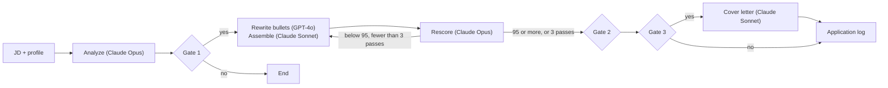

---

## 2. How ResumeForge AI is built

### 2.1 Components

| Component | Path | Purpose |
|---|---|---|
| FastAPI app | `backend/main.py` | Startup: settings, Supabase async client, tool servers, graph. Middleware, routes, `/health`, `/metrics`, error handlers |
| Settings | `backend/core/config.py` | Pydantic `BaseSettings`. The app does not start if a required variable is absent |
| Run state | `backend/agents/state.py` | `ResumeState`, the `TypedDict` of all run fields |
| Graph | `backend/agents/graph.py` | `StateGraph` with 9 nodes, 3 conditional edges, `AsyncPostgresSaver` and 4 `interrupt_before` nodes |
| ATS analyzer node | `backend/agents/ats_analyzer.py` | First ATS score and gap JSON with Claude Opus. Saves the job |
| Resume writer node | `backend/agents/resume_writer.py` | Bullet rewrite with GPT-4o, resume assembly with Claude Sonnet. Saves a resume version |
| ATS rescorer node | `backend/agents/ats_rescorer.py` | New ATS score of the assembled resume with Claude Opus |
| Cover letter node | `backend/agents/cover_letter.py` | Cover letter with Claude Sonnet and the soft skills of the profile |
| Feedback log node | `backend/agents/feedback_log.py` | Writes one `application_logs` row |
| Claude client | `backend/llm/claude_client.py` | `analyze_jd`, `assemble_resume`, `rescore_resume`, `generate_cover_letter`. Retry, circuit breaker, JSON extraction |
| GPT client | `backend/llm/gpt_client.py` | `rewrite_bullets` only. Retry, circuit breaker, JSON array parse |
| Tool servers | `backend/mcp_servers/` | `profile-mcp`, `ats-mcp`, `storage-mcp`, `docgen-mcp`, `log-mcp` and the `MCPRegistry` dispatcher |
| API routes | `backend/api/routes.py` | 7 routes under `/api` |
| Authentication | `backend/api/auth.py` | Supabase JWT check with JWKS. Gives `user_id` from the `sub` claim |
| Guardrails | `backend/core/guardrails.py` | Input limits and LLM output checks |
| Rate limiter | `backend/core/rate_limit.py` | Redis sliding window for each user and action |
| Circuit breaker | `backend/core/circuit_breaker.py` | One breaker for each LLM provider: `claude`, `gpt4o` |
| Errors | `backend/core/exceptions.py` | `AppError` classes with an HTTP status and an error code |
| Logger | `backend/core/logger.py` | JSON logs on stdout with a correlation ID |
| Middleware | `backend/middleware/` | Request log with `X-Correlation-ID`, security headers |
| PDF templates | `backend/templates/` | `resume.html`, `cover_letter.html` for WeasyPrint |
| Migrations | `supabase/migrations/` | `001` to `006`: pgvector, 5 tables, Row Level Security |
| Frontend | `frontend/src/` | React screens, Zustand store, TanStack Query, Supabase JS client |
| Containers | `Dockerfile.backend`, `Dockerfile.frontend`, `docker-compose.yml` | Backend on port 8000, Vite dev server on port 5173 |
| Build specification | `CLAUDE.md` | The full system specification and build order that produced the code |

The component map shows which component calls which component.

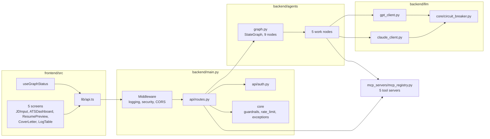

### 2.2 System context

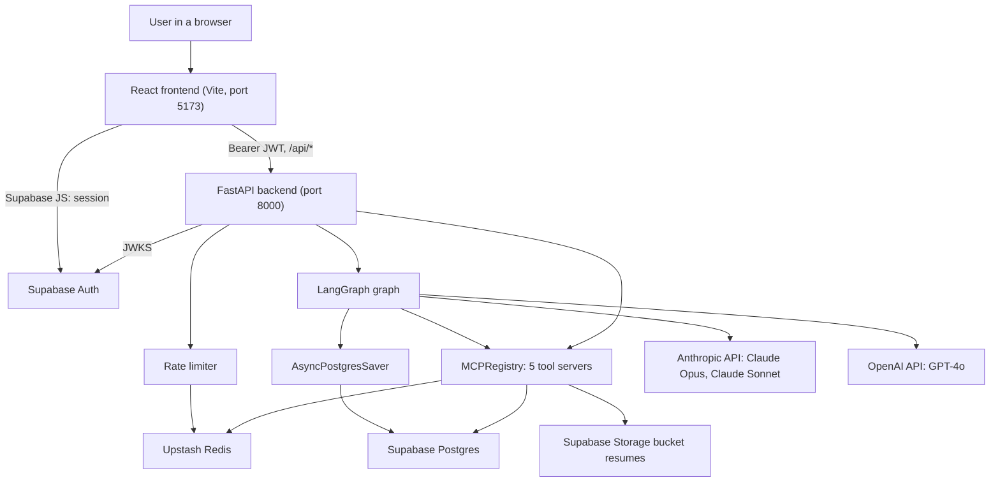

### 2.3 The LLM split

The code keeps a fixed split between the two LLM providers. `CLAUDE.md` gives the reason: GPT-4o writes more varied bullet prose, and Claude is better at structured scoring and document coherence.

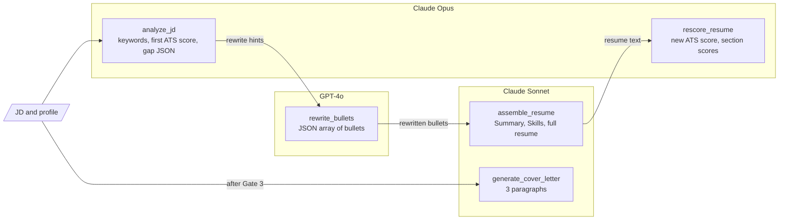

| LLM | Model setting | Tasks | Maximum output tokens |
|---|---|---|---|
| Claude Opus | `claude_opus_model` = `claude-opus-4-5` | JD analysis and first ATS score, rescore of each resume version | 4,096 (analysis), 1,024 (rescore) |
| Claude Sonnet | `claude_sonnet_model` = `claude-sonnet-4-5` | Resume assembly with the Summary and Skills sections, cover letter | 8,192 |
| GPT-4o | `gpt4o_model` = `gpt-4o` | Bullet rewrite only, `temperature=0.7`, JSON response format | 512 for each bullet |

GPT-4o never gets the full resume, never writes a summary and never gives a score.

### 2.4 Repository layout

```
ResumeForge-AI/
├── CLAUDE.md                     # system specification and build order
├── .env.example                  # all variables, placeholder values only
├── docker-compose.yml            # backend + frontend services
├── Dockerfile.backend            # python:3.11-slim + WeasyPrint system libraries
├── Dockerfile.frontend           # node:20-slim builder, nginx production, Vite development
├── docs/ste-style-guide.md       # writing rules and project vocabulary
├── backend/
│   ├── main.py                   # FastAPI app and lifespan
│   ├── requirements.txt
│   ├── agents/                   # state.py, graph.py and the 5 work nodes
│   ├── api/                      # routes.py, auth.py
│   ├── core/                     # config, guardrails, rate_limit, circuit_breaker, exceptions, logger
│   ├── llm/                      # claude_client.py, gpt_client.py
│   ├── mcp_servers/              # base_mcp, mcp_registry and the 5 tool servers
│   ├── middleware/               # logging_middleware.py, security_middleware.py
│   └── templates/                # resume.html, cover_letter.html
├── frontend/
│   ├── package.json  vite.config.ts  tailwind.config.ts  tsconfig.json
│   └── src/
│       ├── App.tsx  main.tsx  index.css
│       ├── components/           # JDInput, ATSDashboard, ResumePreview, CoverLetter, LogTable, ErrorBoundary
│       ├── hooks/                # useGraphStatus.ts, useProfile.ts
│       ├── lib/                  # api.ts, supabase.ts
│       └── store/                # appStore.ts (Zustand)
└── supabase/migrations/          # 001 to 006
```

---

## 3. Design rules

### 3.1 Each LLM has one fixed task
Claude does not write bullets. GPT-4o does not score, structure or render. The rule is in `CLAUDE.md`, in the module docstrings and in the node code. Do not merge the two providers into one.

### 3.2 The graph reaches data only through tool servers
The nodes call `mcp.call_tool(server=..., tool=..., ...)`. They do not import the Supabase client. Only `storage-mcp` and `log-mcp` write rows for jobs, resumes, cover letters and logs. `profile-mcp` writes the profile. Section [18](#18-known-problems) lists one place where the code breaks this rule.

### 3.3 The user decides at three gates
The graph pauses before `show_ats`, `show_resume`, `cover_letter_ask` and `show_cover_letter`. The system writes a resume only after Gate 1. It writes a cover letter only after Gate 3. It never writes a cover letter without a request.

### 3.4 The retry loop has a limit
The ATS pass threshold is 95, not 100. After 3 writer passes, the graph accepts the last resume version, whatever its score.

### 3.5 A tool returns an error object, not an exception
Each tool catches its own exceptions and returns `{"error": str, "code": str}`. `MCPRegistry.call_tool` also changes an unexpected exception into this object. The nodes test for the `error` key.

### 3.6 The client never sees internal details
`AppError.to_dict()` returns only `error` and `message`. The `detail` field is for logs only. An unexpected exception gives HTTP 500 with `INTERNAL_ERROR`.

### 3.7 Secrets come only from the environment
The code reads keys through `get_settings()`. `.env` is in `.gitignore`. The frontend gets only the three public `VITE_` variables.

### 3.8 Each table has Row Level Security
Migration `006` enables Row Level Security on all 5 tables with the policy `user_id = auth.uid()`. The backend uses the service role key, so each tool also filters by `user_id`.

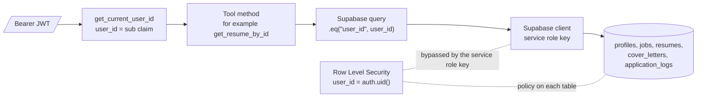

The backend query filter is the only per-user isolation that is active. Row Level Security protects the tables from a client that uses a user session.

### 3.9 Store PDF paths, not PDF files
`docgen-mcp` uploads a PDF to Supabase Storage and returns the storage path. The database stores only a URL or a path in `pdf_url`.

---

## 4. The end-to-end workflow

### 4.1 Full flow

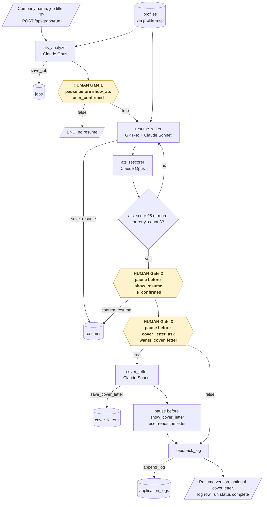

### 4.2 The life cycle of one run

The status route gives one of three status values: `running`, `interrupted` or `complete`. The diagram shows the status and the next node of one run.

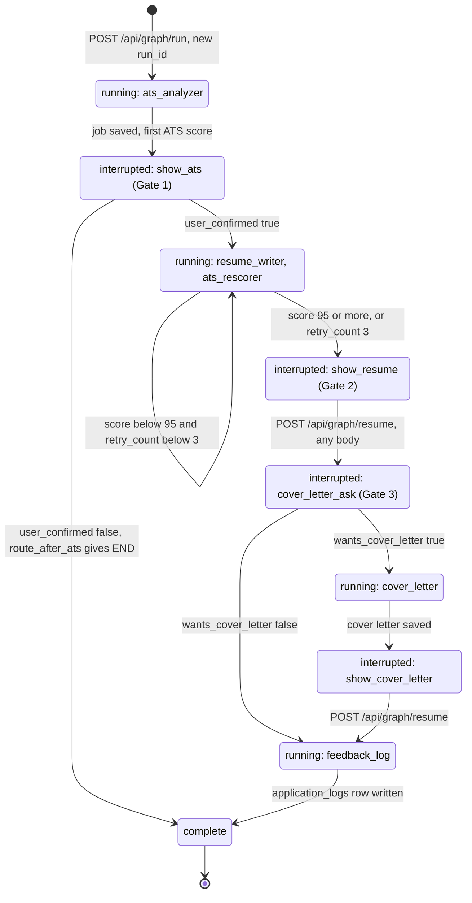

1. The user types a company name and a job title, and pastes the JD on the `/` screen.
2. The frontend sends `POST /api/graph/run`. The backend checks the JWT, the rate limits and the input limits.
3. The backend makes a new `run_id` and starts the graph as an `asyncio` task. The `run_id` is the LangGraph `thread_id`.
4. `ats_analyzer` reads the profile, calls Claude Opus, checks the output and saves a `jobs` row.
5. The graph pauses before `show_ats`. The frontend polls the status and opens the ATS dashboard.
6. The user selects "Generate optimised resume" (Gate 1). The frontend sends `user_confirmed: true`.
7. `resume_writer` rewrites the bullets with GPT-4o and assembles the resume with Claude Sonnet. It saves a resume version.
8. `ats_rescorer` scores the resume with Claude Opus. If the score is below 95 and fewer than 3 passes ran, step 7 runs again.
9. The graph pauses before `show_resume`. The user confirms the resume (Gate 2). The backend calls `confirm_resume`.
10. The graph pauses before `cover_letter_ask`. The user selects "Yes, generate" or "Skip" (Gate 3).
11. If the user selects "Yes, generate", `cover_letter` writes the cover letter, and the graph pauses before `show_cover_letter`.
12. `feedback_log` writes one `application_logs` row. The run is `complete`, and the frontend opens `/logs`.

### 4.3 Who does which step

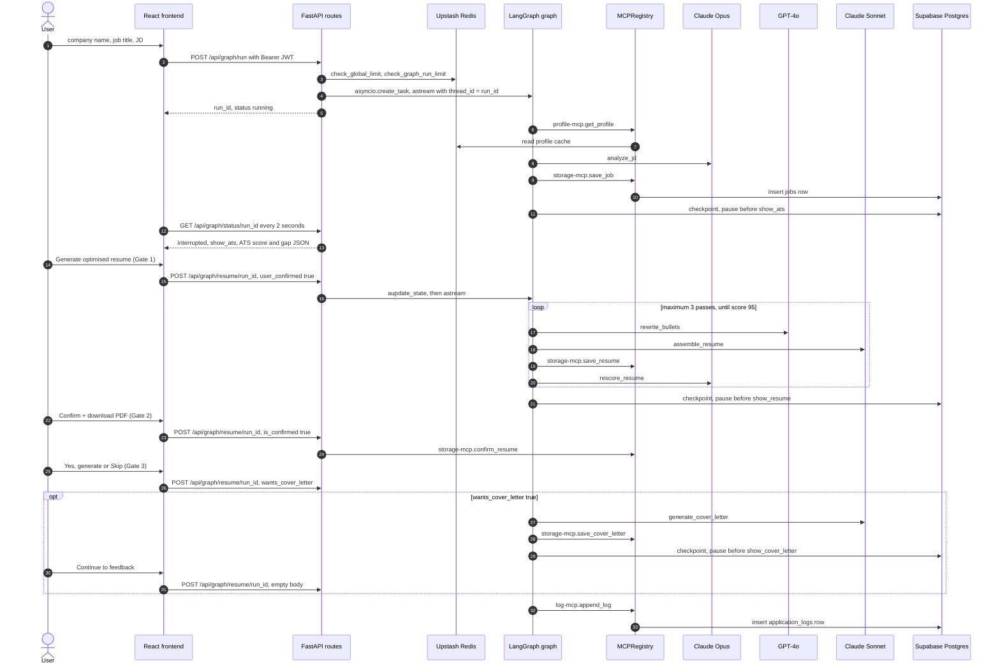

---

## 5. The graph and the run state

**Purpose.** Keep each run as a resumable state machine with pauses for the user.

The diagram shows how the API starts, reads and continues one graph thread.

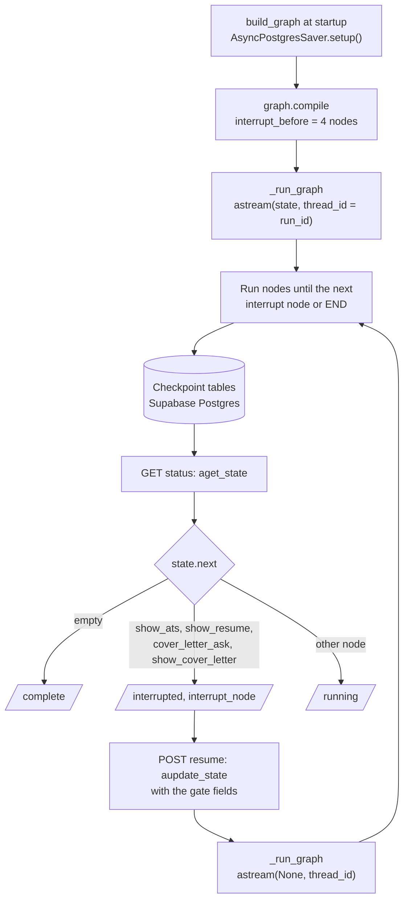

| Node | Kind | LLM | Next |
|---|---|---|---|
| `ats_analyzer` | Work (entry point) | Claude Opus | `show_ats` |
| `show_ats` | Interrupt | — | `route_after_ats`: `resume_writer` or `END` |
| `resume_writer` | Work | GPT-4o, Claude Sonnet | `ats_rescorer` |
| `ats_rescorer` | Work | Claude Opus | `route_after_rescore`: `show_resume` or `resume_writer` |
| `show_resume` | Interrupt | — | `cover_letter_ask` |
| `cover_letter_ask` | Interrupt | — | `route_after_resume_confirm`: `cover_letter` or `feedback_log` |
| `cover_letter` | Work | Claude Sonnet | `show_cover_letter` |
| `show_cover_letter` | Interrupt | — | `feedback_log` |
| `feedback_log` | Work | — | `END` |

The interrupt nodes only write a log line and return `{}`. `graph.compile(interrupt_before=[...])` makes the pause. `functools.partial` binds the `MCPRegistry` to each node.

**The run state (`ResumeState`)**

| Group | Fields |
|---|---|
| Inputs | `user_id`, `job_id`, `jd_text`, `company_name`, `job_title` |
| ATS analysis | `ats_score`, `ats_gap`, `jd_keywords` |
| Generation | `resume_text`, `resume_version`, `retry_count` |
| Gates | `user_confirmed` (Gate 1), `is_confirmed` (Gate 2), `wants_cover_letter` (Gate 3) |
| Outputs | `resume_id`, `cover_letter_text`, `cover_letter_id`, `resume_pdf_url`, `cover_pdf_url` |
| Feedback | `applied`, `applied_on`, `feedback_rating` (1 to 5), `feedback_notes` |
| Internal | `error_message`, `run_id` |

**Rules**

- `build_graph` runs once at startup. It calls `AsyncPostgresSaver.from_conn_string(SUPABASE_DB_URL)` and `checkpointer.setup()`, which makes the checkpoint tables.
- The status route reads `state.next`. No next node gives `complete`. An interrupt node as next node gives `interrupted`. Other values give `running`.
- A node that fails returns `error_message`. The graph does not stop, and the next node runs.

---

## 6. The ATS analyzer and the ATS rescorer

**Purpose.** Give the first ATS score and the gap JSON for a JD, and give a new score for each resume version.

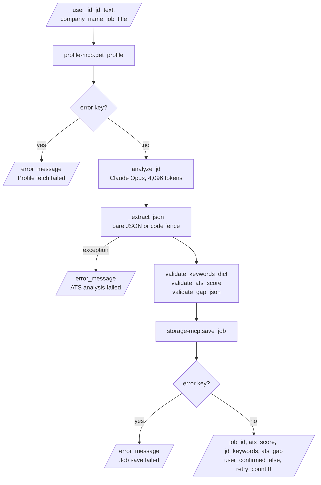

| Node | Input | Output |
|---|---|---|
| `ats_analyzer` | `user_id`, `jd_text`, `company_name`, `job_title` | `job_id`, `ats_score`, `jd_keywords`, `ats_gap`. It sets `user_confirmed`, `retry_count` and `resume_version` to their start values |
| `ats_rescorer` | `resume_text`, `jd_text`, `jd_keywords`, `resume_id`, `retry_count` | New `ats_score`, new `section_scores` and `rescore_feedback` in `ats_gap`, `retry_count + 1` |

**Procedure of `ats_analyzer`**

1. Get the profile with `profile-mcp.get_profile`.
2. Send the JD and the profile to Claude Opus (`analyze_jd`). The prompt includes the skills, experience, education, certifications and the first 3,000 characters of the master resume.
3. Extract the JSON object from the answer. Accept bare JSON or JSON in a Markdown code fence.
4. Check the keywords with `validate_keywords_dict` and the score with `validate_ats_score`.
5. Make the gap JSON and check it with `validate_gap_json`.
6. Save the job with `storage-mcp.save_job`.

**The answer of `analyze_jd`**

| Key | Contents |
|---|---|
| `jd_keywords` | `hard_skills`, `soft_skills`, `tools`, `certifications`, `action_verbs`, `min_years`, `seniority_level` |
| `ats_score` | A number from 0 to 100 |
| `section_scores` | `summary`, `skills`, `experience`, `education`, `certifications` |
| `matched_keywords`, `missing_keywords` | Lists of keywords |
| `experience_gaps` | List of `{gap, action}` |
| `rewrite_hints` | List of `{section, hint}` |

**Procedure of `ats_rescorer`**

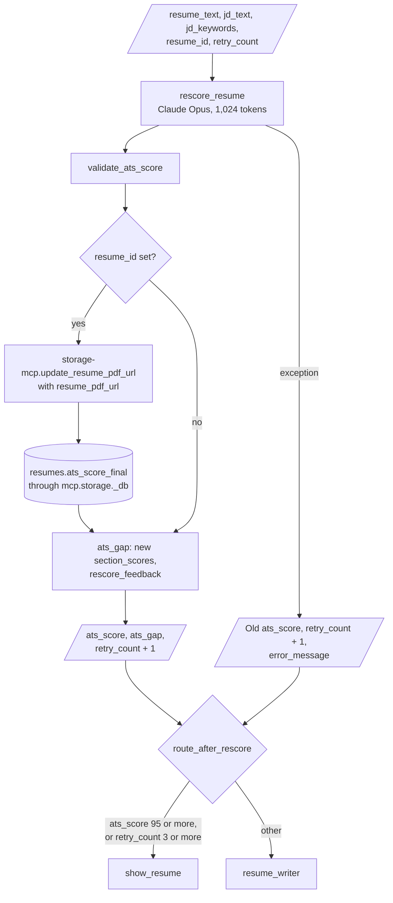

1. Send the first 3,000 characters of the JD, the JD keywords and the resume to Claude Opus (`rescore_resume`).
2. If the call fails, keep the old score, add 1 to `retry_count` and set `error_message`.
3. Check the new score with `validate_ats_score`.
4. Write `ats_score_final` on the `resumes` row.
5. Replace `section_scores` in the gap JSON and add `rescore_feedback`.
6. Add 1 to `retry_count`.

**Routing rule after the rescore**

| Condition | Next node |
|---|---|
| `ats_score >= 95` | `show_resume` |
| `retry_count >= 3` | `show_resume` |
| Other | `resume_writer` (one more pass) |

The two limits come from `ats_pass_threshold` and `ats_max_retries` in `Settings`.

---

## 7. The resume writer

**Purpose.** Make one resume version for the JD from the profile, with GPT-4o bullets and a Claude Sonnet assembly.

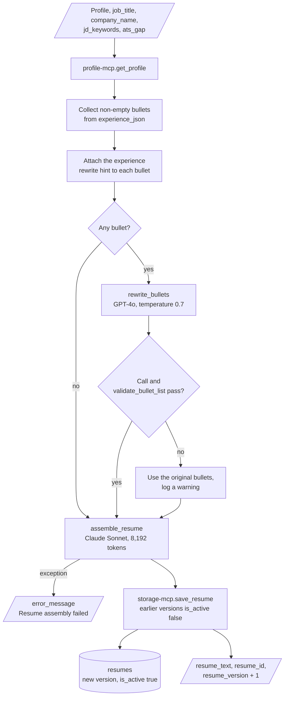

| Input | Output |
|---|---|
| Profile, `job_title`, `company_name`, `jd_keywords`, `ats_gap` | `resume_text`, `resume_id`, `resume_version` (+1) |

**Procedure**

1. Get the profile with `profile-mcp.get_profile`.
2. Collect each non-empty string bullet from `experience_json[].bullets`.
3. Attach the `experience` rewrite hint of the gap JSON to each bullet.
4. Send all bullets in one call to GPT-4o (`rewrite_bullets`). The answer must be a JSON array of strings, in the same sequence.
5. If GPT-4o fails, use the original bullets and log a warning.
6. Send the profile, the bullets, the missing keywords and the rewrite hints to Claude Sonnet (`assemble_resume`).
7. Save the resume version with `storage-mcp.save_resume`. The new version is active, and the earlier versions of the job become inactive.

**The rules in the GPT-4o prompt**

- Start each bullet with a strong action verb.
- Add numbers where possible. The prompt allows estimates.
- Add the suggested keywords only where they fit the original context.
- Keep each bullet to 1 or 2 lines.
- Never invent companies, titles, degrees, certifications or experience.

**The resume format from Claude Sonnet**

```
# [Full Name]
[email] | [phone] | [linkedin]

## Summary
## Skills
## Experience
## Education
## Certifications
```

Claude Sonnet must use the rewritten bullets without change. It writes the Summary and the Skills sections itself, and it adds missing keywords only "where truthful".

---

## 8. The cover letter and the application log

**Purpose.** Write a cover letter only on request, and record each run.

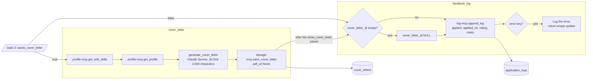

| Node | Input | Output |
|---|---|---|
| `cover_letter` | Profile, soft skills, `job_title`, `company_name`, `jd_text` | `cover_letter_text`, `cover_letter_id` |
| `feedback_log` | `job_id`, `resume_id`, `cover_letter_id` (can be empty), feedback fields | One `application_logs` row |

**Procedure of `cover_letter`**

1. Get the soft skills with `profile-mcp.get_soft_skills`.
2. Get the profile with `profile-mcp.get_profile`.
3. Send the first 2,000 characters of the JD, the experience, the soft skills and the first 10 hard skills to Claude Sonnet.
4. Save the cover letter with `storage-mcp.save_cover_letter`. The code sends `pdf_url=None`.

The prompt asks for 3 paragraphs: an opening, achievement examples and a close. It tells Claude to put the soft skills into the text, not to list them. It forbids phrases such as "I am writing to apply".

**Procedure of `feedback_log`**

1. Read `cover_letter_id`. An empty value becomes `NULL`.
2. Call `log-mcp.append_log` with the applied flag, the date, the rating and the notes.
3. If the call fails, log the error and end the run. The user flow continues.

---

## 9. The tool servers

**Purpose.** Give the graph and the API one controlled path to the database, the cache and the file storage.

The tool servers are in-process Python classes with the names of MCP servers. They do not use the Model Context Protocol. `MCPRegistry` holds one object of each class and sends each `call_tool(server, tool, **kwargs)` to the correct method. An unknown server or tool gives `UNKNOWN_SERVER` or `UNKNOWN_TOOL`.

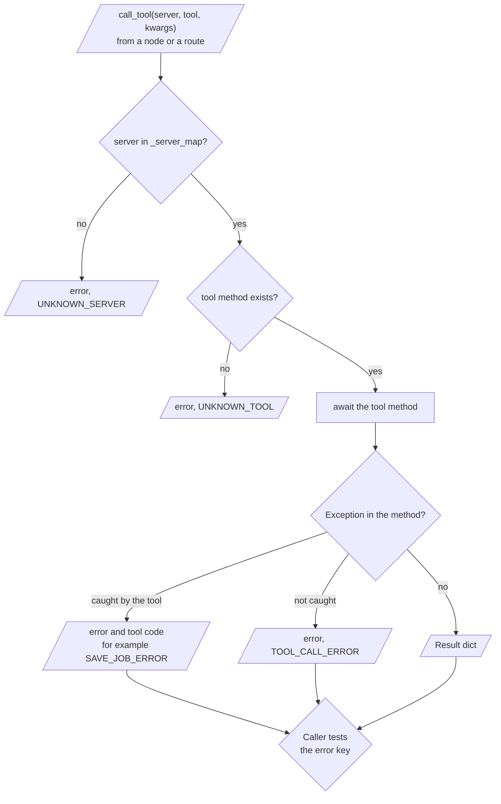

| Server | Class | Tools | Data |
|---|---|---|---|
| `profile-mcp` | `ProfileMCP` | `get_profile`, `get_resume_text`, `get_skills`, `get_soft_skills`, `get_experience`, `update_profile`, `upsert_profile` | `profiles`, Redis `profile:{user_id}` |
| `ats-mcp` | `AtsMCP` | `extract_jd_keywords`, `score_resume`, `get_match_list`, `get_gap_list`, `get_experience_gaps`, `build_gap_json` | None (pure computation) |
| `storage-mcp` | `StorageMCP` | `save_job`, `save_resume`, `confirm_resume`, `update_resume_pdf_url`, `save_cover_letter`, `get_resume_versions`, `get_job_history`, `get_resume_by_id` | `jobs`, `resumes`, `cover_letters` |
| `docgen-mcp` | `DocgenMCP` | `render_resume_pdf`, `render_cover_pdf`, `get_download_url`, `list_templates` | Storage bucket `resumes`, `backend/templates/` |
| `log-mcp` | `LogMCP` | `append_log`, `mark_applied`, `get_all_logs`, `filter_logs`, `get_stats` | `application_logs` with joins to `jobs`, `resumes`, `cover_letters` |

**Rules of `profile-mcp`**

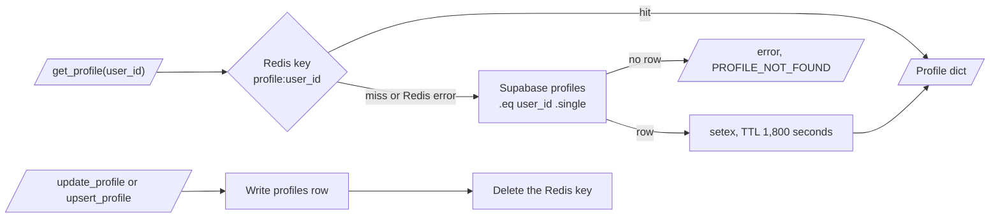

- `get_profile` reads Redis first. On a miss, it reads Supabase and writes the cache with a TTL of 1,800 seconds.
- `update_profile` and `upsert_profile` remove the cache key after the write.
- `upsert_profile` uses `on_conflict="user_id"`, so one user has one profile.
- A Redis failure gives a warning, not an error.

**Rules of `ats-mcp`**

`ats-mcp` is a heuristic fallback with no LLM. `score_resume` cuts the resume into sections by header words and counts the keyword hits. The weights are summary 0.10, skills 0.25, experience 0.45, education 0.10 and certifications 0.10. No node and no route calls `ats-mcp` in the current code.

**Rules of `docgen-mcp`**

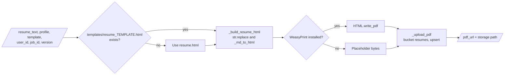

| Tool | Storage path |
|---|---|
| `render_resume_pdf` | `{user_id}/jobs/{job_id}/resume_v{version}.pdf` |
| `render_cover_pdf` | `{user_id}/jobs/{job_id}/cover.pdf` |
| `get_download_url` | A signed URL, valid for 3,600 seconds |

The renderer fills the HTML template with `str.replace`. It changes the Markdown-like resume text to HTML: `#` and `##` headings, `-` and `•` list items, and `**bold**`. If WeasyPrint is not installed, it returns placeholder bytes. No node and no route calls `docgen-mcp` in the current code.

---

## 10. The HTTP API and authentication

**Purpose.** Start, observe and continue runs, and read profiles, resumes and logs for the signed-in user.

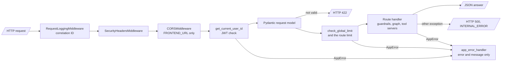

| Method | Path | Rate limits | What it does |
|---|---|---|---|
| `POST` | `/api/graph/run` | global, graph run | Checks the input and starts a new run. Returns `{run_id, status: "running"}` |
| `GET` | `/api/graph/status/{run_id}` | global | Returns `status`, `interrupt_node` and a part of the run state. Returns 403 if another user owns the run |
| `POST` | `/api/graph/resume/{run_id}` | global | Writes the given gate and feedback fields into the run state, then continues the run |
| `GET` | `/api/resume/{resume_id}` | global | Returns one `resumes` row of the user |
| `GET` | `/api/logs?limit=&offset=` | global | Returns the log rows (maximum 100) and the statistics |
| `POST` | `/api/profile` | global, profile update | Creates or updates the profile of the user |
| `GET` | `/api/profile` | global | Returns the profile, or 404 `PROFILE_NOT_FOUND` |
| `GET` | `/health` | — | `{"status": "ok", "version": "1.0.0"}`. Docker uses it for the health check |
| `GET` | `/metrics` | — | `{"status": "ok", "environment": ...}` |

`/docs` and `/redoc` exist only when `ENVIRONMENT=development`.

**The body of `POST /api/graph/resume/{run_id}`**

| Field | Type | Effect |
|---|---|---|
| `user_confirmed` | boolean | Gate 1 |
| `is_confirmed` | boolean | Gate 2. If `true`, the backend also calls `storage-mcp.confirm_resume` |
| `wants_cover_letter` | boolean | Gate 3 |
| `feedback_rating` | integer 1 to 5 | Rating in the log row |
| `feedback_notes` | string, maximum 2,000 characters | Notes in the log row |
| `applied`, `applied_on` | boolean, date string | Application status in the log row |

**Procedure of authentication**

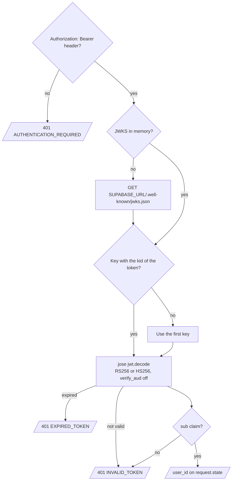

1. Read the `Authorization: Bearer <token>` header. If it is absent, return 401 `AUTHENTICATION_REQUIRED`.
2. Get the JWKS from `{SUPABASE_URL}/.well-known/jwks.json` and keep it in memory.
3. Find the key with the `kid` of the token. If there is no match, use the first key.
4. Decode the token with `RS256` or `HS256`. The audience check is off.
5. Return 401 `EXPIRED_TOKEN` or `INVALID_TOKEN` on failure.
6. Use the `sub` claim as `user_id`, and attach it to `request.state`.

**Error responses**

| HTTP status | Error codes |
|---|---|
| 400 | `VALIDATION_ERROR`, `INPUT_TOO_LONG`, `INPUT_TOO_SHORT`, `MISSING_FIELD` |
| 401 | `AUTHENTICATION_REQUIRED`, `INVALID_TOKEN`, `EXPIRED_TOKEN` |
| 403 | `FORBIDDEN`, `NOT_RESOURCE_OWNER` |
| 404 | `NOT_FOUND`, `PROFILE_NOT_FOUND`, `RESUME_NOT_FOUND`, `JOB_NOT_FOUND`, `RUN_NOT_FOUND` |
| 409 | `CONFLICT` |
| 429 | `RATE_LIMIT_EXCEEDED` |
| 500 | `INTERNAL_ERROR`, `CACHE_ERROR` |
| 503 | `SERVICE_UNAVAILABLE`, `CIRCUIT_OPEN`, `LLM_ERROR`, `CLAUDE_ERROR`, `GPT_ERROR`, `STORAGE_ERROR` |

Each error body is `{"error": "<code>", "message": "<text>"}`.

---

## 11. Guardrails, rate limits and the circuit breaker

**Input guardrails** (before an LLM or a database call)

| Field | Rule | Error |
|---|---|---|
| `jd_text` | Not empty, 50 to 10,000 characters after strip | `MISSING_FIELD`, `INPUT_TOO_SHORT`, `INPUT_TOO_LONG` |
| `company_name`, `job_title` | Not empty, maximum 200 characters | `MISSING_FIELD`, `INPUT_TOO_LONG` |
| `feedback_rating` | Integer from 1 to 5 | `VALIDATION_ERROR` |
| Profile fields | `full_name`, `email` 200, `phone` 50, `linkedin_url` 500, `raw_resume_text` 8,000 characters | Pydantic 422 |

The request model of `POST /api/graph/run` checks the same lengths before the strip. A JD outside 50 to 10,000 characters, or an empty company name or job title, gives HTTP 422 before the guardrails run.

**Output guardrails** (after an LLM call)

| Function | Rule |
|---|---|
| `validate_ats_score` | The score must be a number. A value outside 0 to 100 is clamped and logged |
| `validate_gap_json` | Adds an empty value for each absent key: `missing_keywords`, `experience_gaps`, `section_scores`, `rewrite_hints` |
| `validate_keywords_dict` | Adds an empty value for each absent keyword list and `min_years = 0` |
| `validate_bullet_list` | Keeps only non-empty strings. An empty result is an error |

**Rate limits** (Redis sorted set `rl:{action}:{user_id}`, sliding window)

| Action | Limit | Window |
|---|---|---|
| `global` | 60 requests | 60 seconds |
| `graph_run` | 5 runs | 3,600 seconds |
| `profile_update` | 20 updates | 3,600 seconds |

If Redis is not available, the limiter accepts the request and logs a warning.

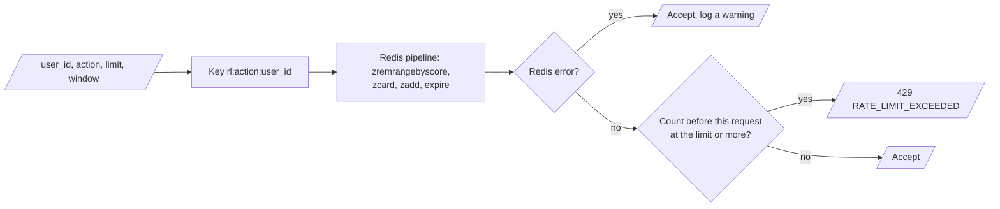

**LLM retries and the circuit breaker**

| Item | Value |
|---|---|
| Attempts for each LLM call | 3 |
| Wait between attempts | `2 ** attempt` seconds (1, 2, 4) plus up to 1 second of random jitter |
| No retry | HTTP 4xx answers other than 429 |
| Breaker opens after | 3 failures (`circuit_breaker_failure_threshold`) |
| Breaker tries again after | 60 seconds (`circuit_breaker_reset_timeout`) |

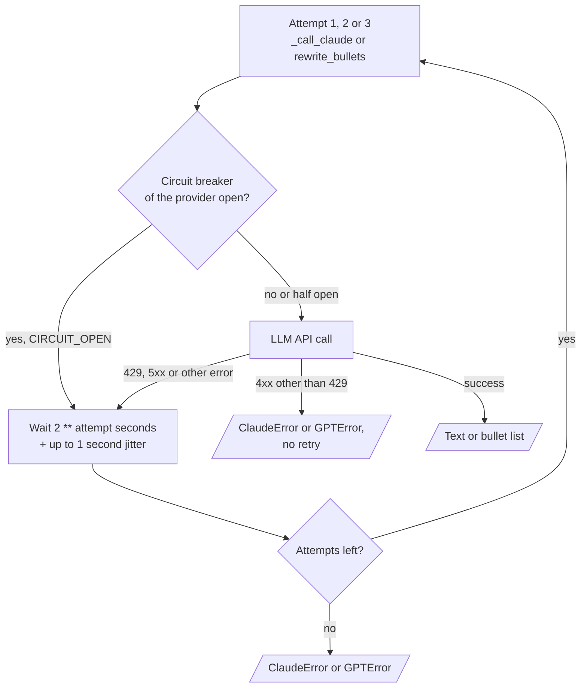

```mermaid
stateDiagram-v2
    [*] --> CLOSED
    CLOSED --> CLOSED: call succeeds, failure count 0
    CLOSED --> OPEN: 3 failures with no success between them
    OPEN --> OPEN: call within 60 seconds raises CircuitOpenError
    OPEN --> HALF_OPEN: first call after 60 seconds
    HALF_OPEN --> CLOSED: call succeeds
    HALF_OPEN --> OPEN: call fails
```

**Logs and headers**

- Each request gets a UUID correlation ID. The logger writes it in each JSON line, and the response returns it in `X-Correlation-ID`.
- Each response has `X-Frame-Options: DENY`, `X-Content-Type-Options: nosniff`, `X-XSS-Protection` and `Referrer-Policy`.
- Outside development, each response also has `Strict-Transport-Security` and `Content-Security-Policy: default-src 'none'`.
- CORS allows only `FRONTEND_URL`.

---

## 12. The database schema

**Purpose.** Keep each profile, job, resume version, cover letter and log row of each user, with per-user isolation.

```mermaid
erDiagram
    AUTH_USERS ||--o| profiles : "has"
    AUTH_USERS ||--o{ jobs : "owns"
    jobs ||--o{ resumes : "has versions"
    jobs ||--o{ cover_letters : "has"
    resumes ||--o{ cover_letters : "is base of"
    jobs ||--o{ application_logs : "is logged in"
    resumes ||--o{ application_logs : "is logged in"
    cover_letters |o--o{ application_logs : "is logged in"
    profiles {
        uuid id PK
        uuid user_id UK
        text full_name
        jsonb skills_json
        jsonb experience_json
        vector embedding
    }
    jobs {
        uuid id PK
        uuid user_id FK
        text jd_raw_text
        jsonb jd_keywords_json
        numeric ats_score_initial
        jsonb ats_gap_json
    }
    resumes {
        uuid id PK
        uuid job_id FK
        integer version
        text generated_text
        numeric ats_score_final
        boolean is_active
        boolean is_confirmed
        text pdf_url
    }
    cover_letters {
        uuid id PK
        uuid resume_id FK
        uuid job_id FK
        text generated_text
        jsonb soft_skills_used
    }
    application_logs {
        uuid id PK
        uuid job_id FK
        uuid resume_id FK
        uuid cover_letter_id FK
        boolean applied
        smallint feedback_rating
        timestamptz logged_at
    }
```

| Migration | Contents |
|---|---|
| `001_enable_pgvector.sql` | `CREATE EXTENSION IF NOT EXISTS vector` |
| `002_create_profiles.sql` | `profiles`, an `ivfflat` cosine index on `embedding`, an `updated_at` trigger |
| `003_create_jobs.sql` | `jobs`, index on `user_id` |
| `004_create_resumes_and_cover_letters.sql` | `resumes` (`ivfflat` index, `(job_id, user_id)` index), `cover_letters` (index on `user_id`) |
| `005_create_application_logs.sql` | `application_logs`, index on `user_id` |
| `006_enable_rls_policies.sql` | Row Level Security and one `FOR ALL USING (user_id = auth.uid())` policy on each table |

| Table | Main columns |
|---|---|
| `profiles` | `user_id` (unique), `full_name`, `email`, `phone`, `linkedin_url`, `raw_resume_text`, `skills_json`, `soft_skills_json`, `experience_json`, `education_json`, `certifications_json`, `master_resume_url`, `embedding vector(1536)` |
| `jobs` | `company_name`, `job_title`, `jd_raw_text`, `jd_keywords_json`, `ats_score_initial numeric(5,2)`, `ats_gap_json` |
| `resumes` | `job_id`, `version`, `generated_text`, `ats_score_final`, `pdf_url`, `is_active`, `is_confirmed`, `confirmed_at`, `embedding vector(1536)` |
| `cover_letters` | `resume_id`, `job_id`, `generated_text`, `soft_skills_used`, `pdf_url` |
| `application_logs` | `job_id`, `resume_id`, `cover_letter_id` (nullable), `applied`, `applied_on`, `feedback_rating` (1 to 5), `feedback_notes`, `logged_at` |

Each table has `id uuid DEFAULT gen_random_uuid()` and `user_id uuid REFERENCES auth.users(id)`.

**The JSON shapes of the profile**

| Column | Shape |
|---|---|
| `skills_json` | `[{skill, level, years}]` |
| `soft_skills_json` | `["leadership", ...]` |
| `experience_json` | `[{company, title, years, bullets[]}]` |
| `education_json` | `[{degree, institution, year}]` |
| `certifications_json` | `["...", ...]` |

---

## 13. The frontend

**Purpose.** Let the user paste a JD, see the scores, make the gate decisions and read the application log.

```mermaid
flowchart TD
    JDI["/ JDInput<br/>api.graph.run"] --> SET["Store runId in Zustand"]
    SET --> POLL["useGraphStatus<br/>GET status every 2 seconds"]
    POLL --> ST{"status and interrupt_node"}
    ST -- "running" --> POLL
    ST -- "interrupted, show_ats" --> ATS["/ats ATSDashboard<br/>Gate 1"]
    ST -- "interrupted, show_resume" --> RP["/resume ResumePreview<br/>Gate 2"]
    ST -- "interrupted, cover_letter_ask<br/>or show_cover_letter" --> CLV["/cover-letter CoverLetter<br/>Gate 3"]
    ST -- "complete" --> LOGS["/logs LogTable<br/>api.logs.list(50, 0)"]
    ST -- "poll error" --> STOP[/"Polling stops"/]
    ATS -- "api.graph.resume<br/>user_confirmed" --> SRV["Backend continues the run"]
    RP -- "api.graph.resume<br/>is_confirmed" --> SRV
    CLV -- "api.graph.resume<br/>wants_cover_letter" --> SRV
```

Only `JDInput` calls `useGraphStatus`, so polling stops after the first interrupt (Known problem 8).

| Route | Screen | Contents and actions |
|---|---|---|
| `/` | `JDInput.tsx` | Company name, job title, JD text area, profile sidebar (name, email, skill count, top 5 skills). "Analyse ATS score" calls `POST /api/graph/run` and starts the poll |
| `/ats` | `ATSDashboard.tsx` | Overall score, 5 section bars, matched keywords (green), missing keywords (red), experience gaps. "Generate optimised resume" or "Not now" (Gate 1) |
| `/resume` | `ResumePreview.tsx` | Resume text with matched keywords in amber (`#FAEEDA`), score badge (green at 95 or more). "Confirm + download PDF" (Gate 2) and "Regenerate" |
| `/cover-letter` | `CoverLetter.tsx` | "Yes, generate" or "Skip" (Gate 3). Then the letter with skills in green (`#E1F5EE`) and "Continue to feedback" |
| `/logs` | `LogTable.tsx` | 4 stat cards, status filter (All, Applied, Pending), score filter (90 %+, 80 %+), search, table of the last 50 rows |
| `*` | — | Goes to `/` |

**Rules**

- `useGraphStatus` polls `GET /api/graph/status/{run_id}` every 2 seconds. It stops at an interrupt or at `complete`, and opens the matching screen.
- The Zustand store keeps `runId`, the ATS data, the resume data, the cover letter data and the job context.
- `api.ts` adds the Supabase access token to each request. A non-2xx answer becomes an `ApiError` with the status and the code.
- `supabase.ts` stops the app if `VITE_SUPABASE_URL` or `VITE_SUPABASE_ANON_KEY` is absent.
- The Vite dev server sends `/api` to `http://localhost:8000`.
- Each screen has an `ErrorBoundary`.

---

## 14. Data and file map

| Location | Committed? | Contents |
|---|---|---|
| `supabase/migrations/*.sql` | Yes | The schema, indexes and Row Level Security policies |
| Supabase table `profiles` | No (database) | One profile for each user |
| Supabase tables `jobs`, `resumes`, `cover_letters`, `application_logs` | No (database) | One job for each run, its resume versions, its cover letter and its log row |
| LangGraph checkpoint tables | No (database) | The run state of each `thread_id`. `checkpointer.setup()` makes them at startup |
| Supabase Storage bucket `resumes` | No (storage) | `{user_id}/jobs/{job_id}/resume_v{n}.pdf` and `cover.pdf`. The migrations do not make this bucket |
| Redis `profile:{user_id}` | No (cache) | Profile cache, TTL 1,800 seconds |
| Redis `rl:{action}:{user_id}` | No (cache) | Rate limit windows |
| `backend/templates/*.html` | Yes | PDF templates |
| `.env` | No (git ignores it) | Local secrets and settings |
| `.env.example` | Yes | All variable names with placeholder values |
| `frontend/dist/`, `node_modules/`, `.venv/` | No (git ignores them) | Build output and dependencies |

---

## 15. How to run ResumeForge AI

### 15.1 Prerequisites

| Need | For |
|---|---|
| A Supabase project with Postgres, Auth and Storage | Database, users, PDF files |
| The direct Postgres connection string of the project | `SUPABASE_DB_URL` for the checkpointer |
| An Upstash Redis database | Profile cache and rate limits |
| An Anthropic API key with access to `claude-opus-4-5` and `claude-sonnet-4-5` | ATS analysis, rescore, assembly, cover letter |
| An OpenAI API key with access to `gpt-4o` | Bullet rewrite |
| Docker with Compose | The container path |
| Python 3.11, Node.js 20 | The path without Docker |
| Pango, Cairo and GDK-PixBuf system libraries | WeasyPrint (installed in `Dockerfile.backend`) |

### 15.2 Database setup

1. Run the six files in `supabase/migrations/` in number sequence, from `001` to `006`. Use the Supabase SQL editor or the Supabase CLI.
2. Make a private Storage bucket with the name `resumes`.
3. Make a user in Supabase Auth. The frontend has no sign-in screen (see [Known problems](#18-known-problems)).
4. Make the profile of the user with `POST /api/profile` and the JWT of that user.

```mermaid
flowchart LR
    M["Run migrations<br/>001 to 006"] --> B["Make the private<br/>Storage bucket resumes"]
    B --> U["Make a user<br/>in Supabase Auth"]
    U --> S["Start the backend<br/>checkpointer.setup()"]
    S --> P["POST /api/profile<br/>with the JWT of the user"]
    P --> R["Open the frontend<br/>and start a run"]
```

Example profile body:

```json
{
  "full_name": "Jane Doe",
  "email": "jane@example.com",
  "skills_json": [{"skill": "Python", "level": "expert", "years": 6}],
  "soft_skills_json": ["leadership", "communication"],
  "experience_json": [{"company": "Acme", "title": "Engineer", "years": 3, "bullets": ["Built the billing API"]}],
  "education_json": [{"degree": "BSc Computer Science", "institution": "State University", "year": 2018}],
  "certifications_json": []
}
```

### 15.3 Run with Docker Compose

```bash
git clone https://github.com/KrishnaAnnavaram/ResumeForge-AI.git
cd ResumeForge-AI
cp .env.example .env              # then write the real values
cp Dockerfile.frontend frontend/  # compose looks for it in frontend/ (Known problem 4)
echo langgraph-checkpoint-postgres >> backend/requirements.txt  # Known problem 2
docker compose up --build
```

| Service | Container | Port | Start condition |
|---|---|---|---|
| `backend` | `resumeforge_backend` | 8000 | — |
| `frontend` | `resumeforge_frontend` | 5173 | The backend health check (`curl -f http://localhost:8000/health`) passes |

Production mode: `ENVIRONMENT=production docker compose up -d --build`.

### 15.4 Run without Docker

Backend, from the repository root:

```bash
python -m venv .venv
. .venv/bin/activate                       # Windows: .venv\Scripts\activate
pip install -r backend/requirements.txt
pip install langgraph-checkpoint-postgres  # absent from requirements.txt (Known problem 2)
python -m uvicorn backend.main:app --reload --port 8000
```

`Settings` reads `.env` from the current directory. Start the backend from the repository root.

Frontend:

```bash
cd frontend
npm install
npm run dev        # http://localhost:5173
npm run build      # tsc + vite build into frontend/dist
npm run lint
```

Vite reads `.env` files from `frontend/`, not from the repository root. Put the three `VITE_` variables in `frontend/.env.local`, or export them in the shell.

### 15.5 Environment variables

| Variable | Required | Used by | Meaning |
|---|---|---|---|
| `ANTHROPIC_API_KEY` | Yes (minimum 10 characters) | Backend | Claude API key |
| `OPENAI_API_KEY` | Yes (minimum 10 characters) | Backend | OpenAI API key |
| `SUPABASE_URL` | Yes (HTTP URL) | Backend | Project URL. Also the base of the JWKS URL |
| `SUPABASE_ANON_KEY` | Yes (minimum 10 characters) | — | Required by `Settings`. The backend does not use it |
| `SUPABASE_SERVICE_ROLE_KEY` | Yes (minimum 10 characters) | Backend | Key of the Supabase client of the tool servers. It bypasses Row Level Security |
| `SUPABASE_DB_URL` | Yes | Backend | Direct Postgres URL for `AsyncPostgresSaver` |
| `UPSTASH_REDIS_URL` | Yes (HTTP URL) | Backend | Redis URL for the cache and the rate limiter (see Known problem 3) |
| `UPSTASH_REDIS_TOKEN` | Yes (minimum 10 characters) | Backend | Redis password |
| `BACKEND_URL` | No, default `http://localhost:8000` | Backend | Logged at startup |
| `FRONTEND_URL` | No, default `http://localhost:5173` | Backend | The only CORS origin |
| `SECRET_KEY` | Yes (minimum 32 characters) | — | Required by `Settings`. The code does not use it. `.env.example` gives a command that makes one |
| `ENVIRONMENT` | No, default `production` | Backend | `development`, `staging` or `production`. `development` enables `/docs` and disables HSTS and CSP |
| `LOG_LEVEL` | No, default `INFO` | Backend | Root log level |
| `VITE_SUPABASE_URL` | Yes | Frontend | Public Supabase URL |
| `VITE_SUPABASE_ANON_KEY` | Yes | Frontend | Public anon key. Do not put a secret here |
| `VITE_BACKEND_URL` | No | Frontend | Backend base URL. Empty means the same origin, with the Vite `/api` proxy |

`Settings` is a pydantic `BaseSettings` class, so each other field can also come from the environment. Examples: `ATS_PASS_THRESHOLD`, `ATS_MAX_RETRIES`, `CLAUDE_OPUS_MODEL`, `CLAUDE_SONNET_MODEL`, `GPT4O_MODEL`, `RATE_LIMIT_GRAPH_RUNS_PER_HOUR`, `REDIS_PROFILE_TTL`, `CIRCUIT_BREAKER_RESET_TIMEOUT`.

---

## 16. How to extend ResumeForge AI

| You want to… | Do this | Code change? |
|---|---|---|
| Change the ATS target or the number of passes | Set `ATS_PASS_THRESHOLD` or `ATS_MAX_RETRIES` | No |
| Use other Claude or OpenAI models | Set `CLAUDE_OPUS_MODEL`, `CLAUDE_SONNET_MODEL` or `GPT4O_MODEL` | No |
| Change the rate limits | Set `RATE_LIMIT_GRAPH_RUNS_PER_HOUR`, `RATE_LIMIT_PROFILE_UPDATES_PER_HOUR` or `RATE_LIMIT_GLOBAL_PER_MINUTE` | No |
| Add a resume template | Add `backend/templates/resume_<id>.html`. `list_templates` finds files with the name `resume_*.html` | Small |
| Add a tool | Add an async method that returns a dict or the error object to a tool server class | Small |
| Add a tool server | Write a `BaseMCP` subclass and add it to `_server_map` in `MCPRegistry` | Small |
| Render PDFs in the flow | Call `docgen-mcp.render_resume_pdf` after Gate 2 and `storage-mcp.update_resume_pdf_url` with the result | Yes |
| Add a gate or a node | Add the node in `graph.py`, add it to `interrupt_before` if it is a gate, and add the field to `ResumeState` | Yes |
| Add sign-in and a profile editor | Add screens that call `supabase.auth` and `api.profile.upsert` | Yes |

Follow the build order in `CLAUDE.md` for large changes: migrations, tool servers, LLM clients, state, nodes, graph, API, `main.py`, frontend.

---

## 17. Validation results

No validation results are recorded in the repository: it has no tests, no CI workflow, no logs and no reports.

---

## 18. Known problems

Read these problems before you run or deploy ResumeForge AI.

| # | Area | Problem | Impact and action |
|---|---|---|---|
| 1 | Tests | The repository has no test files and no CI workflow | No behaviour is verified. Add tests for the routing functions, the guardrails and the tool servers first |
| 2 | Dependencies | `graph.py` imports `langgraph.checkpoint.postgres.aio`. That module is in the `langgraph-checkpoint-postgres` package, which `backend/requirements.txt` does not list | The backend cannot start. Add the package to `requirements.txt` |
| 3 | Redis | `Settings` requires an HTTP URL for `UPSTASH_REDIS_URL`, and `.env.example` gives an `https://` URL. `redis.asyncio.from_url` accepts only `redis://`, `rediss://` and `unix://` | Each Redis call fails. The rate limiter accepts all requests, and the profile cache is off. Change the field type and use the `rediss://` URL of Upstash |
| 4 | Docker | `docker-compose.yml` builds `./frontend` with `Dockerfile.frontend`, but that file is in the repository root. The `production` stage copies `nginx.conf`, which does not exist | The frontend image does not build. Move the Dockerfile into `frontend/` and add `nginx.conf` |
| 5 | Docker | The compose file mounts `./backend` "for hot-reload", but the container command has no `--reload` | Code changes need a container restart |
| 6 | PDF | No node and no route calls `docgen-mcp`. `pdf_url` stays empty. The templates use Jinja tags (``, `{{date}}`), but the code fills them with `str.replace` | "Confirm + download PDF" gives no PDF. Call the renderer after Gate 2 and use a real template engine |
| 7 | PDF | `get_download_url` calls the async storage client without `await`. No migration makes the `resumes` bucket | Signed URLs fail. Add `await` and make the bucket in the setup |
| 8 | Frontend | Only `JDInput` calls `useGraphStatus`. The other screens do not poll | After Gate 1, the screen does not change. Call the hook in each gate screen or in `App.tsx` |
| 9 | Graph | `show_resume` always goes to `cover_letter_ask`. `is_confirmed` does not change the route | "Regenerate" does not make a new version. It moves the run to Gate 3. Add a conditional edge after `show_resume` |
| 10 | Frontend | There is no sign-in screen and no profile editor. The "Create one" profile link goes to `/profile`, which does not exist | Make users in the Supabase dashboard and profiles with `POST /api/profile` |
| 11 | Feedback | The frontend never sends `applied`, `applied_on`, `feedback_rating` or `feedback_notes`. No route calls `mark_applied` | Each log row has `applied = false` and no rating. The "Applied" filter shows nothing |
| 12 | Errors | A failed node sets `error_message`, but the graph continues and the frontend does not show the message | A failed analysis shows an ATS score of 0. Add an error route in the graph and show the message |
| 13 | Auth | The JWKS URL is `{SUPABASE_URL}/.well-known/jwks.json`. Supabase Auth publishes its JWKS under `/auth/v1/.well-known/jwks.json`. The code uses the first key when no `kid` matches, and it disables the audience check | Token checks can fail or be too permissive. Correct the path, require a `kid` match and check `aud` |
| 14 | Isolation | The backend uses the service role key, which bypasses Row Level Security. `BaseMCP._assert_owner` exists, but no tool calls it | Isolation depends on the `user_id` filter in each query. Review each new query for this filter |
| 15 | Design rule | `ats_rescorer` writes `ats_score_final` through `mcp.storage._db`. It also calls `update_resume_pdf_url` with the current `resume_pdf_url`, which is empty | This breaks rule 3.2 and clears `pdf_url`. Add a `storage-mcp` tool for the score |
| 16 | Unused code | `ats-mcp` is never called. The `embedding` columns and `ivfflat` indexes are never filled. The `ats:{user_id}:{job_id}` cache of `CLAUDE.md` is not built. `SECRET_KEY` and `SUPABASE_ANON_KEY` are required but not used | Remove them, or connect them to the flow |
| 17 | Content | The GPT-4o prompt allows estimated numbers. The resume writer gives only the `experience` hint to each bullet | A resume can contain numbers that the user did not give. The user must read each resume before use |
| 18 | Runs | The API starts each run with `asyncio.create_task` in the web worker. Nothing tracks the task | A restart stops a run in the middle of a node. Use a job queue for long runs |
| 19 | Docs | The `claude_client.py` docstring gives waits of 2, 4 and 8 seconds. The code waits 1, 2 and 4 seconds plus jitter. `CLAUDE.md` describes a sync `PostgresSaver` | Trust the code. Update the docstring and `CLAUDE.md` |

---

## 19. Key points

1. **Each LLM has one task.** Claude Opus scores, Claude Sonnet assembles and writes the cover letter, and GPT-4o only rewrites bullets.
2. **The user decides at three gates.** No resume and no cover letter is written without a user decision.
3. **The score loop has a limit.** The target is 95, with a maximum of 3 writer passes.
4. **Each run is a LangGraph thread with a Postgres checkpointer.** The `run_id` is the `thread_id`, and the frontend polls its status.
5. **The graph reaches data through 5 tool servers.** They are in-process Python classes, not MCP protocol servers.
6. **Each table has Row Level Security, but the backend bypasses it.** Each query must filter by `user_id`.
7. **The code is not verified.** There are no tests, and Section [18](#18-known-problems) lists blockers in the backend, the frontend and Docker.

---

## 20. Glossary

| Term | Meaning |
|---|---|
| **Application log** | One row of `application_logs` for one run |
| **ATS** | Applicant tracking system: software that filters resumes by keywords |
| **ATS score** | A number from 0 to 100 that Claude Opus gives for the match of a profile or resume with a JD |
| **Bullet** | One line of experience text in `experience_json` |
| **Checkpointer** | The `AsyncPostgresSaver` that stores the run state in Postgres |
| **Circuit breaker** | The per-provider guard that stops LLM calls for 60 seconds after 3 failures |
| **Gap JSON** | The `ats_gap` object: missing and matched keywords, experience gaps, section scores, rewrite hints |
| **Gate** | One user decision: Gate 1 `user_confirmed`, Gate 2 `is_confirmed`, Gate 3 `wants_cover_letter` |
| **Guardrail** | One validation function in `core/guardrails.py` |
| **Interrupt node** | A node with an `interrupt_before` pause: `show_ats`, `show_resume`, `cover_letter_ask`, `show_cover_letter` |
| **JD** | The job description text that the user pastes |
| **Job** | One row of `jobs`: one JD with its keywords, first ATS score and gap JSON |
| **Node** | One step function of the LangGraph graph |
| **Pass threshold** | The ATS score that stops the retry loop: 95 |
| **Profile** | One row of `profiles`: the contact data, skills, experience, education and certifications of one user |
| **Resume** | The text document that the system makes for one job |
| **Resume version** | One row of `resumes` for one job, with a `version` number |
| **Retry** | One more pass of the resume writer and the ATS rescorer after a score below the pass threshold |
| **Rewrite hint** | One `{section, hint}` item of the gap JSON |
| **Run** | One execution of the graph for one JD, identified by `run_id` |
| **Run state** | The `ResumeState` values of one run |
| **Section score** | The ATS score of one resume section |
| **Tool** | One async method of a tool server |
| **Tool server** | One of the 5 in-process classes in `backend/mcp_servers/`, with a name such as `storage-mcp` |
